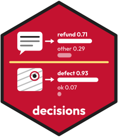

# decisions <a href="https://fmegahed.github.io/decisions/"></a>

<!-- badges: start -->
[](https://github.com/fmegahed/decisions/actions/workflows/R-CMD-check.yaml)
[](https://lifecycle.r-lib.org/articles/stages.html#experimental)
<!-- badges: end -->

The decisions package calls decision models. A decision model reads an input and a typed question. It returns a probability for each allowed answer. The package is inspired by [ellmer](https://ellmer.tidyverse.org): one object names the provider and the model, and one function sends the inputs. The result is a tibble in the tidymodels style. It has one row for each input, a `.pred_class` column and one `.pred_` column for each allowed answer. So yardstick and probably read it without a change.

Each `decide()` call uses one model. A failed call keeps its row, with `NA` answers and the reason in `.error`.

## Installation

Install the development version from GitHub:

``` r
# install.packages("pak")
pak::pak("fmegahed/decisions")
```

After CRAN accepts the package, you can install it from CRAN:

``` r
install.packages("decisions")
```

## Example

This example needs a key. Put the key in the environment variable `TYPESAFE_API_KEY` (see Keys below).

``` r
library(decisions)

jev <- decider_typesafe()
refund <- question_noul("Does the customer ask for a refund?")

decide(
  jev, refund,
  text = "I was charged twice for order 4471. Please refund the extra charge."
)
```

The result has one row. `.pred_true` and `.pred_false` hold the probabilities of the two answers.

## Keys

Each provider has its own key. The help page of each decider says where to get it. Set the key in an environment variable. The best place is `.Renviron`. You can open it with `usethis::edit_r_environ()`. The usethis package is optional.

| Decider | Environment variable | Where to get a key |
|---|---|---|
| `decider_typesafe()` | `TYPESAFE_API_KEY` | [TypeSafe](https://typesafe.ai) |
| `decider_openai()` | `OPENAI_API_KEY` | [OpenAI developer platform](https://platform.openai.com) |
| `decider_openrouter()` | `OPENROUTER_API_KEY` | [OpenRouter keys](https://openrouter.ai/keys) |
| `decider_foundry()` | `AZURE_FOUNDRY_API_KEY` and `AZURE_FOUNDRY_ENDPOINT` | [Microsoft Foundry](https://ai.azure.com) |
| `decider_systemone()` | none for a local server | Laya or Clef-Flash on your own computer |

Never put a key in your code or in a file that you share. A `credentials` function can read the key from a secret store.

## Functions

* Deciders: `decider_typesafe()`, `decider_openai()`, `decider_foundry()`, `decider_openrouter()` and `decider_systemone()`.
* Questions: `question_noul()`, `question_choice()` and `question_score()`.
* Decide: `decide()`.
* Setups: `decision_setup()`, `write_setup()` and `read_setup()`.
* Scoring: `score_setup()` and `evaluate_once()`.

## Vignettes

The vignettes make no network call and need no key. They read saved results. Read them in this order: the first four use text, the last two use images, and each one builds on the ones before it.

* `vignette("getting-started")`: text inputs, the three question types, and scores with known answers.
* `vignette("choosing-a-model")`: how to compare models on the same task.
* `vignette("open-models")`: open models on your own computer.
* `vignette("grading")`: grading short answers with a rubric, and saving the questions as a setup file.
* `vignette("images")`: images as inputs, with reference images.
* `vignette("industrial-image-inspection")`: a complete case study of defect detection in images of manufactured parts (five datasets, three models).

## Learning more

The website <https://fmegahed.github.io/decisions/> has the help pages and the six vignettes:

* `vignette("getting-started")`
* `vignette("choosing-a-model")`
* `vignette("open-models")`
* `vignette("grading")`
* `vignette("images")`
* `vignette("industrial-image-inspection")`

To report a problem or ask for a feature, open an issue at <https://github.com/fmegahed/decisions/issues>.

The examples that call a provider need an API key and a paid call, so they are not run on CRAN.

## Datasets

* `ohio_injuries`: 464 narratives of severe work injuries in Ohio in 2025, with the injury type. Source: the Severe Injury Reports of the U.S. Occupational Safety and Health Administration.
* `ohio_recalls`: 348 food recalls of Ohio firms, with the class of the recall (I, II or III). Source: the food enforcement reports of the U.S. Food and Drug Administration (openFDA).
* `textiles`: 50 simulated images of a woven textile, half of them with a flaw. Source: the R package spc4sts (Bui and Apley, 2021).
* `rubric_answers`: 20 sample answers to one question, each with a label for each question of a rubric. Source: written for this package.

## Agent skill

The package has a skill for coding agents. Copy it into the skills folder of your project:

``` r
skill <- system.file("skills", "decisions", package = "decisions")
dir.create(".claude/skills", recursive = TRUE, showWarnings = FALSE)
file.copy(skill, ".claude/skills", recursive = TRUE)
```

Use `.agents/skills` in place of `.claude/skills` for agents that read that folder.

## Calibration without a key or a network

This example reads the saved results of `vignette("industrial-image-inspection")`. It takes the raw probabilities that Jev gave to 200 test images of textiles (`prob` is the probability of the answer `defective`), and the truth of each image. It maps the probabilities with the Platt scaling that the vignette fitted on separate calibration images. Then it prints the Brier score and the log loss before and after. It uses no key and no network. It can run in webR once the package is on r-universe.

``` r
saved <- readRDS(system.file("extdata", "study_again.rds", package = "decisions"))
sets <- read.csv(system.file("extdata", "study_sets.csv", package = "decisions"))

# The saved test answers of one setup, with the truth of each image
answers <- subset(saved$test$answers, model == "jev" & dataset == "textiles")
answers <- merge(answers, sets[c("image_path", "class")], by = "image_path")
truth <- as.numeric(answers$class == "defective")

# The Platt coefficients, fitted on the calibration images of the same setup
platt <- subset(saved$platt, model == "jev" & dataset == "textiles")
clip <- function(prob) pmin(pmax(prob, 0.005), 0.995)
calibrated <- plogis(platt$intercept + platt$slope * qlogis(clip(answers$prob)))

brier <- function(prob) mean((prob - truth)^2)
log_loss <- function(prob) -mean(truth * log(prob) + (1 - truth) * log(1 - prob))
data.frame(
  probabilities = c("raw", "calibrated"),
  brier = c(brier(answers$prob), brier(calibrated)),
  log_loss = c(log_loss(answers$prob), log_loss(calibrated))
)
```

## Hugging Face Space

A Hugging Face Space with Laya is planned. It is outside the package. There is no link yet.
